<div align="center">



🌐 **English** · [Polski](README.pl.md)

[](https://github.com/damiannass88/RemoteAppTester/releases)
[](LICENSE)


[](https://buymeacoffee.com/damiannass88)

**[🚀 Quick start](#-quick-start)** ·
[🔄 How it works](#-how-it-works) ·
[📱 See it in action](#-see-it-in-action) ·
[🧩 What you can test](#-what-you-can-test) ·
[📚 Docs](#-documentation) ·
[❓ FAQ](#-faq) ·
[☕ Support](#-support-the-project)

</div>

You have an idea for an app. You are not a programmer, but you can describe what you want. An AI
coding agent (for example Claude Code) writes the code. **RemoteAppTester builds it and puts it on
your phone**, through your own private network. You test it, tell the agent what to change, and
repeat. You can do all of it from your phone, wherever you are.

> [!NOTE]
> **Beta (0.6.x).** It works every day for its author, but expect rough edges. Use a test phone and
> test projects. See the [disclaimer](#-disclaimer).

## 🔄 How it works



1. **The AI agent works on its own.** You set it up separately (Claude Code, Codex, Cursor…).
   Claude Code can be driven from the Claude mobile app ("Remote Control"), so you talk to the
   agent from your phone.
2. **When the agent is done, it signals RemoteAppTester** with `rt sg --build` (or `rt push`).
   The agent never gets access to RemoteAppTester itself: it can only leave a note asking for a build.
3. **RemoteAppTester builds the app** with build commands that only you can approve, and sends it
   over [Tailscale](https://tailscale.com), a free private network between your own devices.
   Nothing goes through our servers. We do not have any.
4. **The phone installs and opens the new version.** You test it and write your next request.

## 📱 See it in action





<sub>Animated illustrations of the real screens, with shortened texts.</sub>

## 🧩 What you can test

| | Mode | What happens |
|:-:|---|---|
| 🤖 | **Android apps** (Flutter, Gradle) | Built into an APK, sent to the phone, installed and launched. Only the changed parts are transferred. |
| 🌐 | **Websites and web apps** (Vite, Next.js, Angular, ASP.NET, Django, Flask, Laravel, PHP, static…) | **Preview** starts the dev server on the computer and opens it on the phone, in a phone-sized or desktop-sized view. **Report a problem** saves your note and the browser console to a file the agent reads. |

**Where RemoteAppTester runs**

| | Host | Best for |
|:-:|---|---|
| 🪟 | **Windows 10/11**: windowed app + `rt` command | You have a PC that stays on. The easiest start. |
| 🐧 | **Linux / VPS**: background service + `rt` command | A small rented server (e.g. Contabo, Hetzner, OVH) that works 24/7, also for the AI agent. |
| 📱 | **Android phone**: the remote control | Projects, builds, installs, previews. Locked with your fingerprint. |

**Not supported yet: iPhone/iOS and macOS.** Building for iOS needs a Mac, and the author has no
Apple hardware to test it properly. Help from Mac users is welcome ([CONTRIBUTING.md](CONTRIBUTING.md)).

## 🚀 Quick start

> [!TIP]
> **Not technical?** Every step below has a ready-made prompt in [docs/en/PROMPTS.md](docs/en/PROMPTS.md).
> Paste it into an AI chat (Claude, ChatGPT…), and it guides you step by step and explains every command first.

**1. Download** from [**Releases**](https://github.com/damiannass88/RemoteAppTester/releases) the file for
your computer, plus the phone app:

| File | For |
|---|---|
| `RemoteAppTester-windows-x64-<version>.zip` | Windows PC |
| `RemoteAppTester-linux-<version>.tar.gz` | Linux server / VPS (x64 and arm64 in one package) |
| `RemoteAppTester-android-<version>.apk` | your Android phone |

Each file has a `.sha256` checksum next to it, so you can check the download is complete and untouched.

**2. Tailscale:** create a free account at [tailscale.com](https://tailscale.com) and install Tailscale on
the computer and on the phone, signed in to the same account.

**3. Install on the computer**, whichever setup you chose:

<details>
<summary><b>🪟 Windows PC</b> (easiest)</summary>

1. Unzip the `.zip` file and double-click **`install.cmd`**. It needs no administrator rights.
2. The app opens: **Phones → Pair phone** shows a QR code.
3. **Projects → +** adds the folder with your app. Build commands are filled in automatically.

Details: [host/deploy/windows/README.md](host/deploy/windows/README.md) ·
AI prompt: [prompt 3](docs/en/PROMPTS.md#3-installing-remoteapptester-on-windows)
</details>

<details>
<summary><b>🐧 Linux server / VPS</b> (works 24/7)</summary>

```sh
tar xzf RemoteAppTester-linux-<version>.tar.gz
cd RemoteAppTester-linux-<version>
sudo bash install.sh
```

The installer sets up everything (Flutter, Android SDK, Tailscale, the service) and finally shows the
pairing QR code. Secure the server first.

Step by step: [docs/en/VPS.md](docs/en/VPS.md) · details: [host/deploy/linux/README.md](host/deploy/linux/README.md) ·
AI prompts: [1 (secure the server)](docs/en/PROMPTS.md#1-preparing-and-securing-a-vps),
[2 (install)](docs/en/PROMPTS.md#2-installing-remoteapptester-on-a-linux-server)
</details>

**4. Phone:** install the `.apk` (Android asks you to allow installing from this source), scan the QR
code, and set battery to **"Unrestricted"** for RemoteAppTester and Tailscale.

**5. AI agent:** set it up in your project folder ([prompt 4: VPS](docs/en/PROMPTS.md#4-ai-agent-claude-code-on-a-vps),
[prompt 5: Windows](docs/en/PROMPTS.md#5-ai-agent-claude-code-on-windows)), then send it
[your first request](docs/en/PROMPTS.md#6-first-request-to-the-agent-in-a-project). 🎉

The full walkthrough for beginners is in the **[guide](docs/en/GUIDE.md)**.

## 🔒 Security in brief

- The phone talks to the computer **only inside your Tailscale network**, over TLS with a certificate
  pinned at pairing. Every request is signed.
- The phone **cannot send commands or file paths**. Build commands live in an encrypted database and
  change only when **you** approve them.
- AI agents communicate **only through files** in the project folder.
- The phone app **locks with your fingerprint**. Turning the lock off requires your fingerprint.
- **Your part:** run AI agents in a separate account or machine, and test on a phone without private data.

Details: [docs/en/SECURITY.md](docs/en/SECURITY.md). The main risks are explained honestly in the
app's **Info** tab (also `rt info`).

## 📚 Documentation

| Topic | English | Polski |
|---|---|---|
| 📘 Beginner guide | [GUIDE](docs/en/GUIDE.md) | [PORADNIK](docs/PORADNIK.md) |
| 🤖 Ready-made AI prompts (setup, agent, Google Play, web) | [PROMPTS](docs/en/PROMPTS.md) | [PROMPTY](docs/PROMPTY.md) |
| 🖥️ VPS server step by step | [VPS](docs/en/VPS.md) | [VPS](docs/VPS.md) |
| 🪟 Windows installation | [README](host/deploy/windows/README.md) | [README](host/deploy/windows/README.pl.md) |
| 🐧 Linux installation | [README](host/deploy/linux/README.md) | [README](host/deploy/linux/README.pl.md) |
| 🧠 For AI agents (`rt sg`, `rt push`, exit codes) | [AI_AGENTS](docs/en/AI_AGENTS.md) | [AGENCI_AI](docs/AGENCI_AI.md) |
| 🔒 Security and threat model | [SECURITY](docs/en/SECURITY.md) | [SECURITY](docs/SECURITY.md) |
| ⚖️ Legal notice / privacy policy | [LEGAL](docs/LEGAL.md#in-english) · [PRIVACY](docs/PRIVACY.md#in-english) | [LEGAL](docs/LEGAL.md#po-polsku) · [PRIVACY](docs/PRIVACY.md#po-polsku) |
| 🛠️ Contributing / publishing | [CONTRIBUTING](CONTRIBUTING.md) · [PUBLISHING](docs/en/PUBLISHING.md) | [CONTRIBUTING](CONTRIBUTING.pl.md) · [PUBLISHING](docs/PUBLISHING.md) |

## ❓ FAQ

<details>
<summary><b>Do I need to know how to program?</b></summary>

No. You describe what you want, and the AI agent writes the code. You do need to install a few things
once (Tailscale, RemoteAppTester, the agent), and the [AI prompts](docs/en/PROMPTS.md) walk you through
that. Basic curiosity helps: reading what the agent did and what you approve.
</details>

<details>
<summary><b>What does it cost?</b></summary>

RemoteAppTester is free (MIT). Tailscale has a free plan for personal use. The AI agent is usually a
paid subscription (check the provider's pricing). A VPS costs a monthly fee. A Windows PC you already
have costs nothing extra.
</details>

<details>
<summary><b>Does my code or data go to your servers?</b></summary>

No. There are no RemoteAppTester servers, no analytics and no accounts. Everything stays on your
computer, your phone and your Tailscale network. Your AI provider sees what you send to the agent,
under its own terms. See [PRIVACY](docs/PRIVACY.md#in-english).
</details>

<details>
<summary><b>Can the AI agent damage my computer?</b></summary>

An AI agent can run commands, so it can make mistakes. RemoteAppTester does not give the agent any
extra power: it can only leave a signal file. To protect yourself, run the agent in a separate
account, a virtual machine or on a VPS, and keep backups of your code in git. More in the
[guide](docs/en/GUIDE.md#6-safe-habits-the-most-important-part).
</details>

<details>
<summary><b>Does it work with an iPhone?</b></summary>

Not yet. iOS builds need a Mac, and the author has no Apple hardware to test them. Contributions from
Mac users are welcome.
</details>

<details>
<summary><b>Can I publish my app on Google Play?</b></summary>

RemoteAppTester is for **testing** (debug builds). Publishing is a separate step with its own rules
(developer account, signing key, privacy policy, store testing requirements).
[Prompt 8](docs/en/PROMPTS.md#8-releasing-an-app-on-google-play) walks you through it with an AI chat,
and [prompt 9](docs/en/PROMPTS.md#9-releasing-a-web-app) does the same for websites.
</details>

## 🔧 Building from source

See [host/README.md](host/README.md), [desktop_app/README.md](desktop_app/README.md) and
[android_app/README.md](android_app/README.md). Release packages:
`host/tool/build_release.ps1 -WithAndroid` (Windows + APK) and `host/tool/build_release.sh` (Linux, Docker).
The illustrations on this page are generated by `python tool/readme/make_art.py`.
Design notes (PL): [docs/PROJECT_ASSUMPTIONS.md](docs/PROJECT_ASSUMPTIONS.md),
[docs/IMPLEMENTATION_PLAN.md](docs/IMPLEMENTATION_PLAN.md).

## ☕ Support the project

RemoteAppTester is free and open source. If it saves you time, you can
**[buy the author a coffee](https://buymeacoffee.com/damiannass88)**. Donations are voluntary and buy no
support, warranty or features.

Contributions are welcome: [CONTRIBUTING.md](CONTRIBUTING.md). Security issues: [.github/SECURITY.md](.github/SECURITY.md).

## 📜 Disclaimer

Provided **"as is", without warranty of any kind** (see [LICENSE](LICENSE)). You are responsible for
your computers, servers, phones, the code your AI agents write and run, the apps you install, and
your use of third-party services (Tailscale, Google, your VPS provider, AI providers) under their
terms. More in [docs/LEGAL.md](docs/LEGAL.md). RemoteAppTester is an independent project. It is not
affiliated with or endorsed by Anthropic, Google, Tailscale or any other company named here.
All trademarks belong to their owners.
