<div align="center">



🌐 [English](README.md) · **Polski**

[](https://github.com/damiannass88/RemoteAppTester/releases)
[](LICENSE)


[](https://buymeacoffee.com/damiannass88)

**[🚀 Szybki start](#-szybki-start)** ·
[🔄 Jak to działa](#-jak-to-działa) ·
[📱 Zobacz w akcji](#-zobacz-w-akcji) ·
[🧩 Co przetestujesz](#-co-przetestujesz) ·
[📚 Dokumentacja](#-dokumentacja) ·
[❓ Pytania](#-pytania-i-odpowiedzi) ·
[☕ Wsparcie](#-wsparcie-projektu)

</div>

Masz pomysł na aplikację. Nie jesteś programistą, ale potrafisz opisać, czego chcesz. Kod pisze agent
AI (na przykład Claude Code). **RemoteAppTester buduje aplikację i wgrywa ją na Twój telefon** przez
Twoją prywatną sieć. Testujesz, mówisz agentowi, co poprawić, i tak w kółko. Wszystko to możesz robić
z telefonu, gdziekolwiek jesteś.

> [!NOTE]
> **Wersja beta (0.6.x).** Autor używa jej codziennie, ale mogą zdarzyć się niedoróbki. Używaj
> telefonu testowego i projektów testowych. Zobacz [zastrzeżenia](#-zastrzeżenia).

## 🔄 Jak to działa



1. **Agent AI pracuje sam.** Konfigurujesz go osobno (Claude Code, Codex, Cursor…). Claude Code
   można prowadzić z aplikacji Claude na telefonie („Remote Control”), więc rozmawiasz z agentem
   z telefonu.
2. **Gdy agent skończy, daje znać RemoteAppTesterowi** poleceniem `rt sg --build` (albo `rt push`).
   Agent nie dostaje dostępu do samego RemoteAppTestera: może tylko zostawić notatkę z prośbą o build.
3. **RemoteAppTester buduje aplikację** komendami, które tylko Ty możesz zatwierdzić, i wysyła ją
   przez [Tailscale](https://tailscale.com), darmową prywatną sieć między Twoimi urządzeniami.
   Nic nie przechodzi przez nasze serwery. Nie mamy żadnych.
4. **Telefon instaluje i otwiera nową wersję.** Testujesz ją i piszesz kolejną prośbę.

## 📱 Zobacz w akcji





<sub>Animowane ilustracje prawdziwych ekranów, ze skróconymi tekstami.</sub>

## 🧩 Co przetestujesz

| | Tryb | Co się dzieje |
|:-:|---|---|
| 🤖 | **Aplikacje Android** (Flutter, Gradle) | Build do pliku APK, wysyłka na telefon, instalacja i uruchomienie. Przesyłane są tylko zmienione części. |
| 🌐 | **Strony i aplikacje WWW** (Vite, Next.js, Angular, ASP.NET, Django, Flask, Laravel, PHP, statyczne…) | **Podgląd** uruchamia serwer deweloperski na komputerze i otwiera stronę na telefonie, w widoku telefonu albo komputera. **Zgłoś problem** zapisuje Twoją uwagę i konsolę przeglądarki do pliku, który czyta agent. |

**Gdzie działa RemoteAppTester**

| | Komputer | Dla kogo |
|:-:|---|---|
| 🪟 | **Windows 10/11**: aplikacja okienkowa + polecenie `rt` | Masz komputer, który może być włączony. Najprostszy start. |
| 🐧 | **Linux / VPS**: usługa w tle + polecenie `rt` | Mały wynajęty serwer (np. Contabo, Hetzner, OVH), który działa 24/7, także dla agenta AI. |
| 📱 | **Telefon z Androidem**: pilot | Projekty, buildy, instalacje, podglądy. Blokowany odciskiem palca. |

**Jeszcze nie: iPhone/iOS i macOS.** Budowanie na iOS wymaga Maca, a autor nie ma sprzętu Apple, żeby
to rzetelnie przetestować. Pomoc osób z Makiem jest mile widziana ([CONTRIBUTING.pl.md](CONTRIBUTING.pl.md)).

## 🚀 Szybki start

> [!TIP]
> **Nie jesteś techniczny?** Każdy krok poniżej ma gotowy prompt w [docs/PROMPTY.md](docs/PROMPTY.md).
> Wklej go do czatu AI (Claude, ChatGPT…), a czat poprowadzi Cię krok po kroku i najpierw wyjaśni każde polecenie.

**1. Pobierz** z [**Releases**](https://github.com/damiannass88/RemoteAppTester/releases) plik dla
komputera oraz aplikację na telefon:

| Plik | Dla |
|---|---|
| `RemoteAppTester-windows-x64-<wersja>.zip` | komputer z Windows |
| `RemoteAppTester-linux-<wersja>.tar.gz` | serwer Linux / VPS (x64 i arm64 w jednej paczce) |
| `RemoteAppTester-android-<wersja>.apk` | Twój telefon z Androidem |

Obok każdego pliku jest suma `.sha256`, którą sprawdzisz, czy plik pobrał się w całości i nikt go nie zmienił.

**2. Tailscale:** załóż darmowe konto na [tailscale.com](https://tailscale.com) i zainstaluj Tailscale na
komputerze i na telefonie, zalogowany tym samym kontem.

**3. Instalacja na komputerze**, zależnie od wybranego wariantu:

<details>
<summary><b>🪟 Komputer z Windows</b> (najprościej)</summary>

1. Rozpakuj plik `.zip` i kliknij dwa razy **`install.cmd`**. Nie wymaga uprawnień administratora.
2. Otworzy się aplikacja: **Telefony → Sparuj telefon** pokaże kod QR.
3. **Projekty → +** dodaje folder z aplikacją. Komendy budowania wpiszą się same.

Szczegóły: [host/deploy/windows/README.pl.md](host/deploy/windows/README.pl.md) ·
prompt AI: [prompt 3](docs/PROMPTY.md#3-instalacja-remoteapptester-na-windows)
</details>

<details>
<summary><b>🐧 Serwer Linux / VPS</b> (działa 24/7)</summary>

```sh
tar xzf RemoteAppTester-linux-<wersja>.tar.gz
cd RemoteAppTester-linux-<wersja>
sudo bash install.sh
```

Instalator przygotuje wszystko (Flutter, Android SDK, Tailscale, usługę), a na końcu pokaże kod QR do
parowania. Najpierw zabezpiecz serwer.

Krok po kroku: [docs/VPS.md](docs/VPS.md) · szczegóły: [host/deploy/linux/README.pl.md](host/deploy/linux/README.pl.md) ·
prompty AI: [1 (zabezpieczenie serwera)](docs/PROMPTY.md#1-przygotowanie-i-zabezpieczenie-serwera-vps),
[2 (instalacja)](docs/PROMPTY.md#2-instalacja-remoteapptester-na-serwerze-linux)
</details>

**4. Telefon:** zainstaluj plik `.apk` (Android poprosi o zgodę na instalację z tego źródła), zeskanuj
kod QR i ustaw baterię na **„Bez ograniczeń”** dla RemoteAppTester i Tailscale.

**5. Agent AI:** skonfiguruj go w folderze projektu ([prompt 4: VPS](docs/PROMPTY.md#4-agent-ai-claude-code-na-serwerze-vps),
[prompt 5: Windows](docs/PROMPTY.md#5-agent-ai-claude-code-na-windows)), a potem wyślij mu
[pierwszą prośbę](docs/PROMPTY.md#6-pierwsza-prośba-do-agenta-w-projekcie). 🎉

Pełny opis dla początkujących jest w **[poradniku](docs/PORADNIK.md)**.

## 🔒 Bezpieczeństwo w skrócie

- Telefon łączy się z komputerem **tylko w Twojej sieci Tailscale**, przez TLS z certyfikatem
  przypiętym przy parowaniu. Każde żądanie jest podpisane.
- Telefon **nie może wysłać poleceń ani ścieżek plików**. Komendy budowania są w zaszyfrowanej bazie
  i zmieniają się tylko po **Twoim** zatwierdzeniu.
- Agenci AI porozumiewają się **wyłącznie przez pliki** w folderze projektu.
- Aplikacja na telefonie **blokuje się odciskiem palca**. Wyłączenie blokady wymaga odcisku.
- **Twoja część:** uruchamiaj agentów AI na osobnym koncie albo maszynie i testuj na telefonie bez
  prywatnych danych.

Szczegóły: [docs/SECURITY.md](docs/SECURITY.md). Główne ryzyka są uczciwie opisane w zakładce
**Informacje** w aplikacji (także `rt info`).

## 📚 Dokumentacja

| Temat | Polski | English |
|---|---|---|
| 📘 Poradnik dla początkujących | [PORADNIK](docs/PORADNIK.md) | [GUIDE](docs/en/GUIDE.md) |
| 🤖 Gotowe prompty AI (instalacja, agent, Google Play, WWW) | [PROMPTY](docs/PROMPTY.md) | [PROMPTS](docs/en/PROMPTS.md) |
| 🖥️ Serwer VPS krok po kroku | [VPS](docs/VPS.md) | [VPS](docs/en/VPS.md) |
| 🪟 Instalacja na Windows | [README](host/deploy/windows/README.pl.md) | [README](host/deploy/windows/README.md) |
| 🐧 Instalacja na Linuksie | [README](host/deploy/linux/README.pl.md) | [README](host/deploy/linux/README.md) |
| 🧠 Dla agentów AI (`rt sg`, `rt push`, kody wyjścia) | [AGENCI_AI](docs/AGENCI_AI.md) | [AI_AGENTS](docs/en/AI_AGENTS.md) |
| 🔒 Bezpieczeństwo i model zagrożeń | [SECURITY](docs/SECURITY.md) | [SECURITY](docs/en/SECURITY.md) |
| ⚖️ Informacje prawne / polityka prywatności | [LEGAL](docs/LEGAL.md#po-polsku) · [PRIVACY](docs/PRIVACY.md#po-polsku) | [LEGAL](docs/LEGAL.md#in-english) · [PRIVACY](docs/PRIVACY.md#in-english) |
| 🛠️ Współpraca / publikacja | [CONTRIBUTING](CONTRIBUTING.pl.md) · [PUBLISHING](docs/PUBLISHING.md) | [CONTRIBUTING](CONTRIBUTING.md) · [PUBLISHING](docs/en/PUBLISHING.md) |

## ❓ Pytania i odpowiedzi

<details>
<summary><b>Czy muszę umieć programować?</b></summary>

Nie. Opisujesz, czego chcesz, a kod pisze agent AI. Raz trzeba zainstalować kilka rzeczy (Tailscale,
RemoteAppTester, agenta), a [prompty AI](docs/PROMPTY.md) przeprowadzą Cię przez to. Przyda się
ciekawość: czytanie, co zrobił agent i co zatwierdzasz.
</details>

<details>
<summary><b>Ile to kosztuje?</b></summary>

RemoteAppTester jest darmowy (MIT). Tailscale ma darmowy plan do użytku osobistego. Agent AI to
zwykle płatna subskrypcja (sprawdź cennik dostawcy). Serwer VPS to opłata miesięczna. Komputer z
Windows, który już masz, nic dodatkowo nie kosztuje.
</details>

<details>
<summary><b>Czy mój kod albo dane trafiają na Wasze serwery?</b></summary>

Nie. RemoteAppTester nie ma serwerów, analityki ani kont. Wszystko zostaje na Twoim komputerze,
telefonie i w Twojej sieci Tailscale. Dostawca AI widzi to, co wysyłasz agentowi, na swoich
zasadach. Zobacz [PRIVACY](docs/PRIVACY.md#po-polsku).
</details>

<details>
<summary><b>Czy agent AI może zepsuć mi komputer?</b></summary>

Agent AI uruchamia polecenia, więc może się pomylić. RemoteAppTester nie daje mu żadnych dodatkowych
uprawnień: agent może tylko zostawić plik sygnału. Dla bezpieczeństwa uruchamiaj agenta na osobnym
koncie, w maszynie wirtualnej albo na VPS i trzymaj kopię kodu w git. Więcej w
[poradniku](docs/PORADNIK.md#6-bezpieczne-nawyki-najważniejsze).
</details>

<details>
<summary><b>Czy działa z iPhone'em?</b></summary>

Jeszcze nie. Budowanie na iOS wymaga Maca, a autor nie ma sprzętu Apple, żeby to przetestować.
Pomoc osób z Makiem jest mile widziana.
</details>

<details>
<summary><b>Czy mogę wydać aplikację w Google Play?</b></summary>

RemoteAppTester służy do **testowania** (wersje debug). Wydanie to osobny krok z własnymi zasadami
(konto dewelopera, klucz podpisu, polityka prywatności, wymagania testów w sklepie).
[Prompt 8](docs/PROMPTY.md#8-wydanie-aplikacji-w-google-play) przeprowadzi Cię przez to z czatem AI,
a [prompt 9](docs/PROMPTY.md#9-wydanie-aplikacji-www) zrobi to samo dla stron WWW.
</details>

## 🔧 Budowanie ze źródeł

Zobacz [host/README.pl.md](host/README.pl.md), [desktop_app/README.pl.md](desktop_app/README.pl.md) i
[android_app/README.pl.md](android_app/README.pl.md). Paczki wydania:
`host/tool/build_release.ps1 -WithAndroid` (Windows + APK) i `host/tool/build_release.sh` (Linux, Docker).
Ilustracje na tej stronie generuje `python tool/readme/make_art.py`.
Notatki projektowe: [docs/PROJECT_ASSUMPTIONS.md](docs/PROJECT_ASSUMPTIONS.md),
[docs/IMPLEMENTATION_PLAN.md](docs/IMPLEMENTATION_PLAN.md).

## ☕ Wsparcie projektu

RemoteAppTester jest darmowy i otwarty. Jeśli oszczędza Ci czas, możesz
**[postawić autorowi kawę](https://buymeacoffee.com/damiannass88)**. Wsparcie jest dobrowolne i nie kupuje
pomocy technicznej, gwarancji ani funkcji.

Chcesz pomóc w rozwoju? [CONTRIBUTING.pl.md](CONTRIBUTING.pl.md). Problemy bezpieczeństwa:
[.github/SECURITY.md](.github/SECURITY.md#zgłaszanie-po-polsku).

## 📜 Zastrzeżenia

Program jest udostępniany **„tak jak jest”, bez jakiejkolwiek gwarancji** (zobacz [LICENSE](LICENSE)).
Odpowiadasz za swoje komputery, serwery i telefony, za kod, który piszą i uruchamiają Twoi agenci AI,
za instalowane aplikacje i za korzystanie z usług innych firm (Tailscale, Google, dostawca VPS,
dostawcy AI) zgodnie z ich regulaminami. Więcej w [docs/LEGAL.md](docs/LEGAL.md#po-polsku).
RemoteAppTester jest niezależnym projektem, niepowiązanym z Anthropic, Google, Tailscale ani innymi
wymienionymi firmami i niepopieranym przez nie. Znaki towarowe należą do ich właścicieli.
